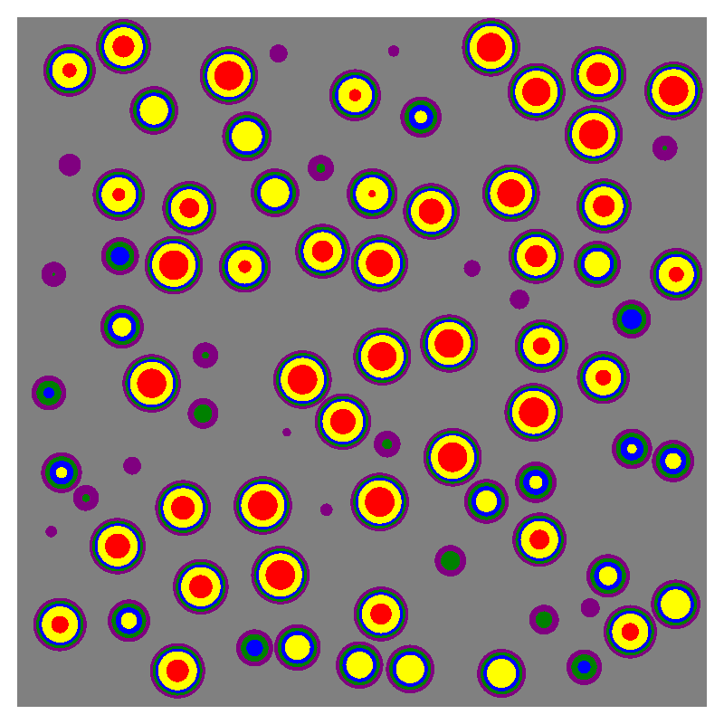
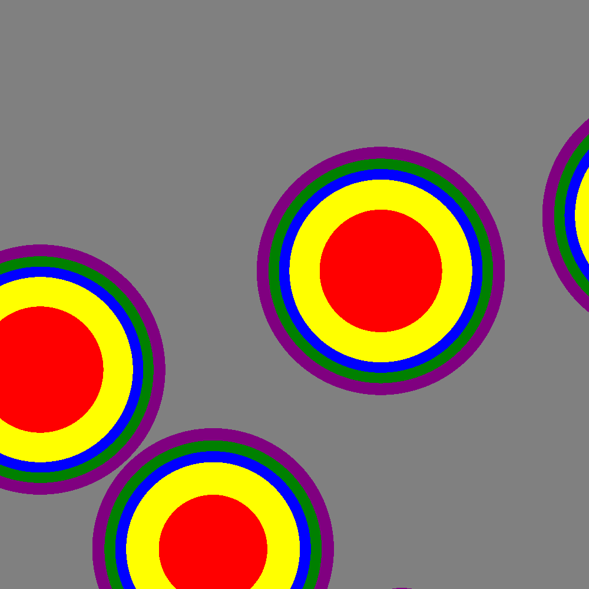

# OpenMC Learning Projects: UO2 Pincell and TRISO Fuel

Two small OpenMC models I built to learn how the library works, plus a mockup of the Radiant Kaleidos core that sets up the next step. Both models are modified versions of examples from the [OpenMC documentation](https://docs.openmc.org/), split into separate files and heavily commented.

## About This Repo

- **Source material.** Both projects come from the OpenMC documentation examples. The physics setups are theirs. What I changed is the structure.
- **Claude's role.** Claude refactored the provided example code into separate, less overwhelming files and explained what each piece does. I then wrote the code comments myself, in my own words and to my own understanding, when I felt they were needed. Working through those explanations is how I learned how the library works.
- **Timeline.** All of this was done on Sunday, October 18 and Monday morning, October 19, 2026.
- **My level of understanding.** I have a strong but not complete understanding of everything in here. I am currently taking reactor physics and have not completed it yet, so some of the physics and some modeling choices are things I am still learning. If something looks off, it may well be. I have a near complete understanding of how the code itself works and am familiar with Python Syntax

## Projects

### 1. UO2 Pincell (PWR-style)

A classic pressurized water reactor pincell:

- UO2 fuel
- Gap
- Zirconium cladding
- Water moderator
- Criticality calculation (k-effective)

Based on the pincell example in the OpenMC documentation.

### 2. TRISO Fuel Model

A k-infinity calculation of a TRISO-in-graphite medium, the kind of fuel used in high temperature gas-cooled reactors. The geometry is a 1 cm cube with reflective faces, so it represents an infinite medium and not a finite compact. Each particle has the usual layered structure (fuel kernel, buffer, pyrolytic carbon, silicon carbide, outer pyrolytic carbon). The fuel is 14% enriched, and the particles fill 30% of the volume, randomly packed in a graphite matrix.

Based on the TRISO example in the OpenMC documentation.

### 3. Kaleidos Mockup (`kaleidos-mockup_claude/`)

A Claude-generated image of the Kaleidos core. This is not a working model yet. It is the target for the next phase of the project.

**Planned next steps:** model the core in OpenMC using what I learned from the two completed examples above. The plan is:

- Use a quartered geometry with reflective boundary conditions on the cut walls, so only a quarter of the core needs to be simulated.
- Model how reactivity changes as the boron absorber arcs on the control drums are rotated, running a sweep of drum angles and tracking k-effective at each one.
- Define each material with the properties OpenMC needs, as they become necessary: density, elemental (or nuclide) composition, and scattering properties.
- Account for temperature effects where they matter, such as temperature-dependent cross sections.
- Choose the axial geometry and its boundary conditions deliberately, since the mockup only shows the axial midplane and neutron leakage out of the top and bottom of the core will matter.

**What I still need to learn before the model is realistic.** The mockup uses illustrative dimensions, and a simulation that could reasonably be expected to reach criticality needs more than a good-looking geometry. I do not yet fully understand:

- **Geometric positioning of components.** Where the fuel, coolant channels, control drums, reflector, and shield sit relative to each other, and their real dimensions.
- **Neutron sourcing.** Where and how to place the initial source neutrons so the fission source converges to a sensible distribution.
- **Generations to discard.** How many inactive batches the criticality calculation needs before the results are trustworthy, which I plan to check with Shannon entropy and multiple random seeds as I did for the TRISO model.
- **Pressure vessel materials.** What the vessel is made of and how much it matters to the neutron balance.

**Quantities of interest.** Beyond k-effective, I want to tally the neutrons that escape through the gaps between the boron arcs on the control drums, and to look at the flux and power distribution across the core. Comparing these across drum angles should show how effective the boron arcs are at absorbing neutrons.

## Requirements

This repo relies on OpenMC, so it needs one of the following:

- **Windows:** run inside a Docker container with OpenMC installed.
- **Linux:** run natively with OpenMC installed.

You will also need cross section data available to OpenMC (the `OPENMC_CROSS_SECTIONS` environment variable pointing to your `cross_sections.xml`).

### Running with Docker (Windows)

1. Install Docker Desktop.
2. Start a container with OpenMC and mount this repo into it:

   ```
   docker run -it --rm -v "%cd%":/work -w /work <openmc-image> bash
   ```

   Replace `<openmc-image>` with the OpenMC image you are using. In PowerShell, use `${PWD}` instead of `%cd%`.
3. Inside the container, run the scripts as described below.

### Running natively (Linux)

Install OpenMC (see the [OpenMC install guide](https://docs.openmc.org/en/stable/usersguide/install.html)), set up cross section data, then run the scripts from the repo root.

## Usage

Run each project from its own folder.

**UO2 pincell**

```
cd pincell
python pincell_main.py
```

Writes the OpenMC input files, runs the eigenvalue calculation, prints k-effective, and writes `pinplot.png`.

**TRISO compact**

```
cd triso-example
python trisoex_main.py
```

Optional flags: `--seeds N` (run N transport seeds and report the spread in k), `--particles`, `--batches`, `--inactive`. Each seed runs in its own `run_seed_<N>/` folder, and the plots are written for seed 1.

## Results

Fill these in after running each model.

| Model | k-effective | Settings | Notes |
|---|---|---|---|
| UO2 pincell | 1.4023 ± 0.0030 | 100 batches, 10 inactive, 1000 particles | Combined estimator; collision 1.4013, track-length 1.4009, absorption 1.4026 |
| TRISO compact | 1.0655 ± 0.0031 | 100 batches, 10 inactive, 1000 particles | Single seed (combined estimator); Shannon entropy flat at ~5.93 |

Multi-seed TRISO run (`python trisoex_main.py --seeds 3`): seeds 1 to 3 gave k = 1.0655, 1.0672 and 1.0657. Mean k = 1.0661, spread (std) = 0.0010, which is consistent with the statistical error of each run (about 0.003).

Cross section library and OpenMC version used: NNDC HDF5 (294 K), OpenMC 0.15.3





## Repo Structure

```
.
├── pincell/                    # UO2 pincell project
├── triso-example/              # TRISO compact project
├── kaleidos-mockup_claude/     # Claude-generated Kaleidos core image (modeling is a future step)
│   └── kaleidos_mockup.png
└── README.md
```

## Acknowledgments

- The OpenMC development team and documentation, for the original examples.
- Claude (Anthropic), for refactoring and commenting the code and generating the Kaleidos core mockup.
